<div align="center">

# QUARK

**A tiny desk display for Codex usage and live Windows telemetry.**

ESP32-C3 · 128×64 OLED · USB serial · Windows companion

</div>

[](https://github.com/shaxntanu/QUARK/actions/workflows/ci.yml)

QUARK pairs an ESP32-C3 SuperMini with a monochrome OLED. A lightweight Windows companion reads local PC metrics and Codex App Server usage, then sends them to the device over USB. A physical switch selects Codex or system pages; a button advances pages or requests a refresh.



## At a glance

- **Codex:** today's and lifetime tokens, seven-day token trend, five-hour and weekly allowance, usage streaks, and longest running turn.
- **PC:** CPU load and frequency, memory use and free memory, NVIDIA GPU load/temperature/VRAM, system-drive use/free space, network throughput, uptime, battery state when available, and a ChatGPT HTTPS reachability check.
- **OLED:** one clear metric or a pair of related readings per page, with line charts for changing values.
- **Connection:** USB reconnects automatically. A brief connection chime plays once after the selected feed is stable; temporary Codex errors keep the last readings visible until they age out.
- **Status LEDs:** blue for a healthy selected feed, red for offline/error, and red plus blue while connecting or refreshing. The faulty green channel is unused.

## Project status

The repository contains a Windows companion, ESP32-C3 firmware, KiCad source, and fabrication exports. The companion and firmware source identify themselves as version 1.2.0; the latest published GitHub release is `v1.1.0`. This audit rebuilt the software and checked the CAD files, but did not perform a new hardware-in-the-loop session.

The project is an engineering prototype and personal telemetry utility. It does not claim research novelty or measured performance results. No `LICENSE` file is present, so reuse and redistribution terms have not been specified.

## Engineering docs

- [Architecture and interfaces](docs/architecture.md)
- [Requirements and scope](docs/requirements.md)
- [Data collection methodology](docs/methodology.md)
- [Hardware integration](docs/hardware.md)
- [Verification evidence](docs/verification.md)
- [Traceability matrix](docs/traceability.md)
- [Security notes](docs/security.md)
- [Limitations](docs/limitations.md) and [roadmap proposals](docs/roadmap.md)
- [Decision records](docs/decisions/)
- [Dependency inventory](docs/sbom.md)
- [KiCad workflow research notes](docs/research-notes.md)
- [Repository audit summary](docs/audit.md)

The HTTPS indicator only checks whether the computer can open a TCP connection to `chatgpt.com` on port 443. It helps distinguish a general network problem from a Codex App Server problem; it does not prove that Codex authentication or usage requests are working.

## OLED pages

### Codex mode

1. Tokens today, with lifetime tokens in the footer.
2. Seven-day token trend, normalized to the busiest day in that period, with the peak count.
3. Five-hour allowance remaining and its reset estimate.
4. Weekly allowance remaining and its reset estimate.
5. Current and longest usage streak.
6. Longest running Codex turn.

### System mode

1. CPU load and current frequency.
2. Memory used and available memory.
3. GPU load and temperature.
4. GPU memory use.
5. System-drive use and free space.
6. Download and upload rates with separate trend charts.
7. ChatGPT HTTPS reachability, system uptime, and battery state when available.

NVIDIA GPU readings require `nvidia-smi`; they show `--` when that tool or a supported GPU is unavailable. CPU temperature is not reported because Windows' standard psutil interface does not provide it reliably.

## Hardware

The carrier PCB is designed for an **ESP32-C3 SuperMini 2×8** module and an SH1106 128×64 OLED.

| Part | ESP32-C3 GPIO |
|---|---:|
| OLED SDA | 0 |
| OLED SCL | 1 |
| Page/refresh button | 3 |
| Status LED red | 4 |
| Passive piezo buzzer | 5 |
| Codex/System switch | 6 |
| Status LED blue | 10 |

The button and switch use `INPUT_PULLUP` and should connect to GND when closed. Use current-limiting resistors for the red and blue LED channels. GPIO 7's faulty green channel is not used.

The KiCad schematic, PCB, BOM, previews, Gerbers, and drill files are in [`hardware/QUARK_SuperMini_Carrier`](hardware/QUARK_SuperMini_Carrier/README.md).

## Install the Windows companion

Build the standalone executable with Python 3.12:

```powershell
.\scripts\build_exe.ps1
```

Install it, add it to the current Windows user's Startup folder, and launch it:

```powershell
.\scripts\install_startup.ps1
```

The companion detects the QUARK serial device, reconnects after unplug/replug, and keeps PC telemetry running while Codex data is unavailable. Rotating diagnostic logs are stored in `%LOCALAPPDATA%\QUARK\quark.log`.

To remove the startup shortcut:

```powershell
.\scripts\remove_startup.ps1
```

Codex pages require the Codex CLI to be installed and signed in for the same Windows user. PC pages work independently. For diagnostics, run `py -3.12 .\quark.py --self-test`; list serial ports with `py -3.12 .\quark.py --list-ports`.

## Flash the firmware

1. Install the Arduino ESP32 core 3.x and the U8g2 library.
2. Open `QUARK.ino` in Arduino IDE and select an ESP32-C3 board.
3. Enable **USB CDC On Boot**.
4. Upload the sketch and close Serial Monitor before the companion connects.

The sketch uses `U8G2_SH1106_128X64_NONAME_F_HW_I2C`. Change the constructor if your OLED uses another controller. The companion does not flash the board.

## USB serial protocol

Messages are newline-terminated ASCII at 115200 baud. Values unavailable on the current computer are sent as `--`.

```text
AI|TODAY=18.4K|LIFE=1.42M|H5=74|WEEK=61|H5R=2h14m|WR=3d4h|PEAK=4.2K|STREAK=3|BEST=12|LONGEST=2h14m|D7=0,10,38,22,100,56,64
SYS|CPU=42|GPU=68|RAM=57|TEMP=71|VRAM=36|DISK=62|FREE=14.2G|DFREE=215G|DN=1.2M|UP=84K|DNP=24|UPP=3|FREQ=3.6G|SYSUP=3d4h|BAT=87|AC=ON|WEB=OK
```

The ESP32 answers `PING` with `PONG` for device discovery. It also accepts `MODE|AI`, `MODE|SYS`, `REFRESH|AI`, and `REFRESH|SYS`.

## Build firmware from the command line

With Arduino CLI and the required ESP32 core and U8g2 library installed:

```powershell
arduino-cli compile --fqbn esp32:esp32:esp32c3:CDCOnBoot=cdc .
```

## Development

Run the Python regression suite with Python 3.12:

```powershell
py -3.12 -m unittest discover -s tests -v
```

See [CONTRIBUTING.md](CONTRIBUTING.md) for the repeatable build and review workflow, and [SECURITY.md](SECURITY.md) for vulnerability reporting. Citations for version 1.2.0 are described in [CITATION.cff](CITATION.cff). The project has no declared license yet.

## Repository layout

```text
QUARK.ino                         ESP32-C3 firmware and OLED UI
quark.py                          Windows telemetry/Codex companion
tests/test_quark.py               Python unit and protocol regression tests
scripts/                          Windows packaging and startup scripts
hardware/QUARK_SuperMini_Carrier/ KiCad design, BOM, and fabrication files
docs/                             Architecture, verification, security, and audit docs
.github/                          CI and dependency update configuration
```
