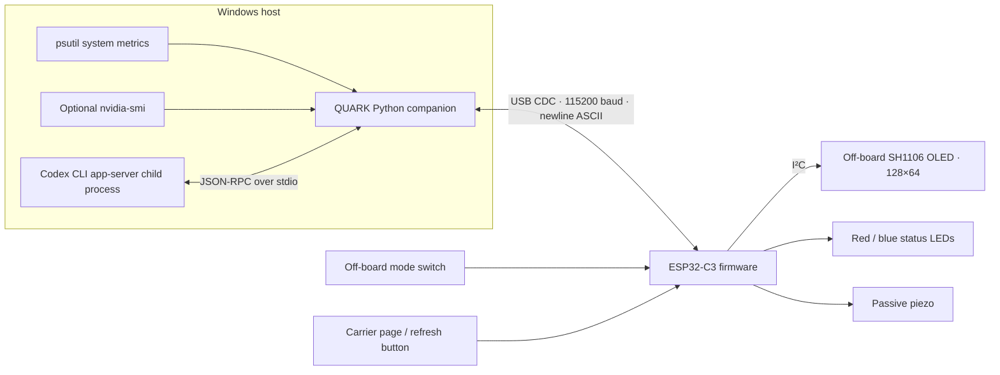

# Architecture

QUARK is a local desktop-to-embedded telemetry system. The Windows companion gathers operating-system metrics and asks the installed Codex CLI for Codex usage data. It sends compact ASCII records over USB serial to an ESP32-C3. Firmware chooses the active view and drives the OLED, status LEDs, and piezo.

The illustration is a static explanatory view, not an assembly drawing and not to scale. The board dimensions and electrical connections are documented in [hardware.md](hardware.md) and the KiCad project.

## Components and boundaries

The companion runs as a single Windows process, with separate Codex polling and serial/telemetry work. System metrics are sampled about every 2 seconds. Codex usage is polled about every 60 seconds, with retries and a bounded refresh cooldown. The App Server reader queues only JSON-RPC responses that can satisfy a pending request; unsolicited notifications and server requests are ignored. NVIDIA readings are optional. The application has no HTTP telemetry endpoint or remote QUARK service; the Codex CLI itself may communicate with OpenAI services.

## Serial protocol

The link is 115200 baud, newline-terminated printable ASCII. The complete line, including its newline, is limited to 160 bytes. The companion omits lower-priority optional fields when necessary to keep a packet within that bound. The firmware counts every byte before LF, including CR, and discards malformed, oversized, or non-ASCII lines. The companion also decodes commands strictly as ASCII and accepts only known command strings.

| Direction | Message | Purpose |
|---|---|---|
| Firmware → companion | `PING` | Device discovery and handshake request |
| Companion → firmware | `PONG` | Successful firmware handshake |
| Companion → firmware | `SYS|...` | Windows telemetry, normally every 2 seconds |
| Companion → firmware | `AI|...` | Codex usage snapshot, normally every 60 seconds or on refresh |
| Firmware → companion | `MODE|AI`, `MODE|SYS` | Selected mode changed |
| Firmware → companion | `REFRESH|AI`, `REFRESH|SYS` | User requested refresh |
| Firmware → companion | `QUARK|READY` | Firmware startup announcement |

The companion polls Codex account data in a background thread, so a slow or unavailable Codex request does not stop PC telemetry. System data continues to be sent when Codex is offline. The device displays the selected feed and retains recent readings until its mode-specific freshness timeout expires.

## Device state and feedback

System samples are considered fresh for 6 seconds; Codex samples for 90 seconds. Switching mode starts a 1.5-second connection grace period. After the selected feed is healthy for a further 400 milliseconds, the firmware plays a single acknowledgement sound for that mode selection. The status channels are blue for healthy, red for offline/error, and red plus blue for connecting or refreshing. GPIO 7's green LED channel is intentionally unused.

The physical switch is read by the firmware. Page and refresh button behavior is local to the device; refresh requests are sent over serial. The OLED is off-board and uses I²C. See [hardware.md](hardware.md) for the pin map.

## Deployment

The source companion runs under Python 3.12. `scripts/build_exe.ps1` packages it as a one-file Windows executable. `scripts/install_startup.ps1` adds a shortcut for the current Windows user; the application writes rotating logs under that user's local application-data directory. The firmware is built separately with Arduino CLI or the Arduino IDE. The checked-in 4 MB firmware image is a convenience artifact; see [verification.md](verification.md) for what was and was not reproduced during this audit.
